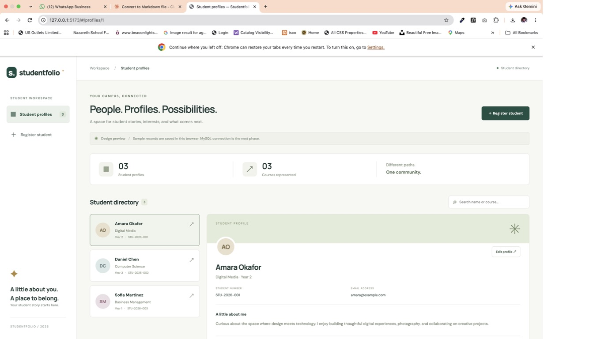
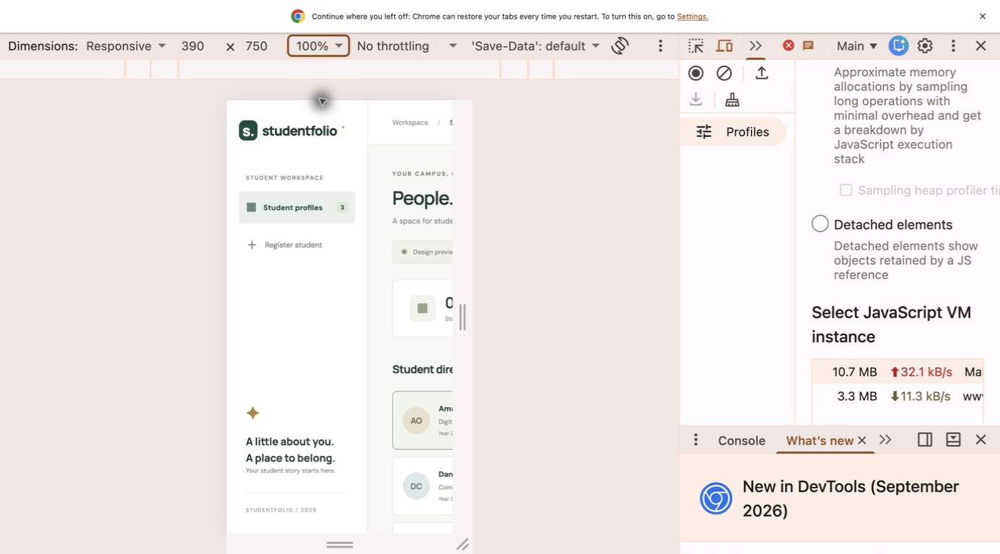
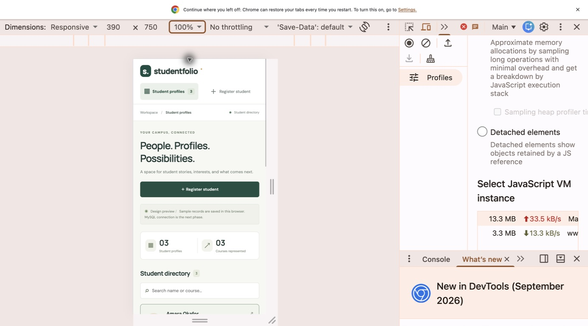
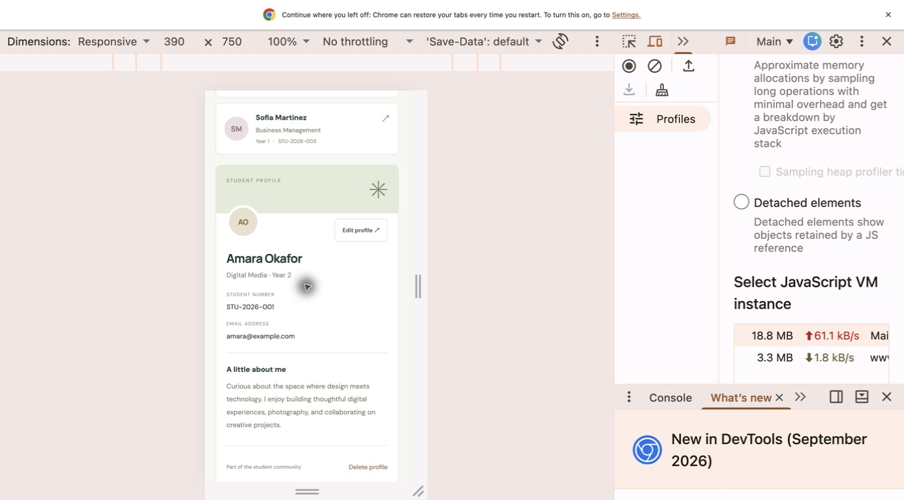
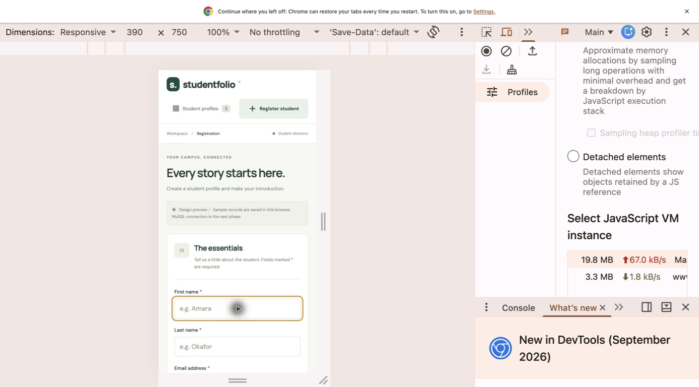
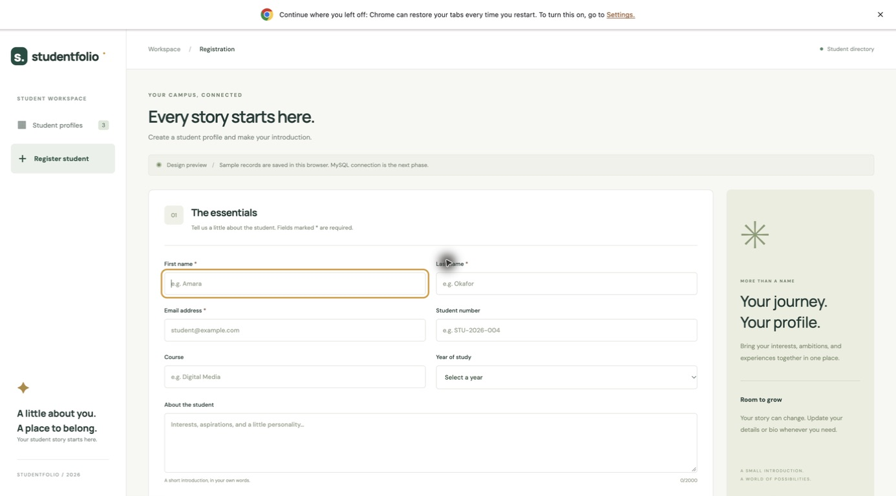

# Frontend design and responsive iteration

## Scope and current result

Studentfolio is a browser-based React single-page web app. It has registration and profile views, a searchable student directory, and create/read/update/delete interactions. It uses JavaScript, React Query, and Zustand. The existing Express server remains CommonJS. The screenshots document the fictional-data, browser-storage design stage. After capturing that stage, MySQL migration and API integration were completed. The active app now stores records through Express in MySQL.

## Iteration 1: desktop first

The initial layout used a 244px sidebar, a fixed 1,200px minimum body width, a directory beside the profile, and a two-column registration form. A green, cream, and white palette separates navigation, content, and actions. Student initials provide identifiable avatars without requiring image uploads.

The original stylesheet is preserved in `frontend/evidence/desktop-only.css`. The first desktop screenshot was captured before responsive rules were added.

## Observed mobile failure

A narrow viewport was checked using Chrome DevTools. The original CSS retained the desktop minimum width: the sidebar took most of the visible phone area and profile content extended beyond the right edge. At a fitted preview scale, text became very small. This was an observed implementation problem, not simulated artwork.

The comparison screenshot above was captured at a 390 × 750 CSS-pixel viewport and 100% DevTools preview zoom. After the first 390 × 844 check, the preview was adjusted for clearer evidence; the preserved original stylesheet was temporarily reapplied to make the comparison at the same final viewport and zoom. The current stylesheet was restored immediately afterwards.

## Iteration 2: responsive correction

The corrected CSS removes the fixed desktop minimum width and supports a minimum width of 320px. Breakpoints at 1,250px, 1,000px, and 700px progressively adjust the available space.

| Problem | Implemented correction |
| --- | --- |
| Sidebar consumes phone width | Replace it with a top brand row and two navigation links |
| Directory and profile exceed viewport | Stack the directory and profile vertically |
| Form fields become cramped | Use one column on phones and full-width controls |
| Desktop promotional panel competes with the form | Hide the supplementary registration panel on smaller screens |
| Small mobile inputs | Use 16px input text and controls at least 44px high where specified |
| Long bio/email content | Wrap text within the profile card |
| Tight header and search layout | Stack headings, primary action, and search at phone width |

The phone screenshots use the DevTools responsive viewport, not physical device testing. Screenshots include the browser and DevTools so viewport settings and the surrounding capture context remain visible. The corrected mobile captures show readable navigation, stacked cards, form fields, and profile details within the phone viewport. This is a visual check at the documented width, not a claim that every device has been tested.

## Interaction and state management

- Registration validates required names and email, offers optional student number/course/year/bio, saves, and opens the created profile.
- Profiles display saved information and provide edit/cancel/save and delete confirmation.
- React Query reads records and runs save/delete mutations. Successful mutations invalidate the student list so the directory and selected profile reflect the saved data.
- Zustand stores shared search and notification state. Unsaved form inputs remain component state, while the selected profile ID is in the URL hash.
- Hash routes (`#/register`, `#/profiles`, `#/profiles/:id`) keep this a single-page web app and allow browser refresh without server route configuration.
- The temporary data adapter in `frontend/src/data.js` is the replacement point for future Express requests. It prevents duplicate emails and student numbers for this preview. Database validation remains necessary later.

The implementation follows the documented [React Query mutation pattern](https://tanstack.com/query/latest/docs/framework/react/guides/mutations) and [Zustand store pattern](https://zustand.docs.pmnd.rs/learn/getting-started/introduction).

## Verification record

| Check | Observed result |
| --- | --- |
| Initial desktop rendering | Sidebar, directory, and selected profile rendered |
| Original CSS on narrow viewport | Desktop columns overflowed; captured before correction |
| Corrected 390px viewport | Navigation and content stacked; profile and form screenshots captured |
| Create disposable Test Student record | Success notice, new directory item, and profile displayed |
| Edit bio and save | Updated bio and success notice displayed |
| Refresh created profile | Saved bio and profile remained available |
| Confirm deletion of disposable test record | Record removed, directory returned to three samples |
| Production build | Passed using Vite 6.4.5; dependency `use client` directives produce non-blocking bundler warnings |
| Package install/audit | Completed with zero reported vulnerabilities after compatible Vite patch |

No peer feedback, screen-reader audit, or real-device check has been performed. Live database checks were subsequently completed and are recorded separately. Browser autocomplete suggestions may be available when focusing fields; the app does not read or save those suggestions automatically.

## Subsequent phase: MySQL integration (completed)

1. Review the single-table migration and inspect the existing database structure before applying it.
2. Apply the forward migration and verify the actual table in MySQL.
3. Add a MySQL connection pool to Express using server-only environment settings.
4. Implement and validate the documented student CRUD endpoints using parameterised SQL.
5. Replace the browser data adapter with HTTP requests; retain React Query and Zustand responsibilities.
6. Verify end-to-end create/read/update/delete, duplicate handling, errors, and persistence after restarting the server.

The six screenshots above intentionally preserve the design-stage preview notice and sample records. They are not screenshots of the final MySQL-connected state. The active frontend no longer reads browser records. The original browser adapter is retained in `frontend/evidence/browser-data-adapter.js`. See [the database migration record](database-migration-record.md) for the actual integration results.

Demo browser records were not imported into MySQL. With no authentication, this is a shared directory application rather than private student-owned profiles.

A final attempt to recheck the connected app in Chrome was blocked because the computer-use service could no longer find the browser window. The completed visual checks and screenshots predate integration; the final integrated frontend build and API proxy were verified separately.
